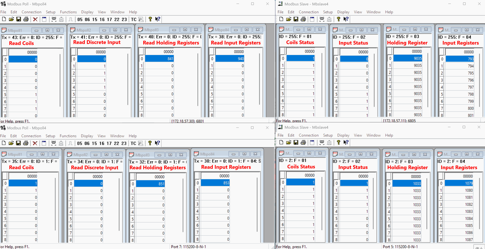
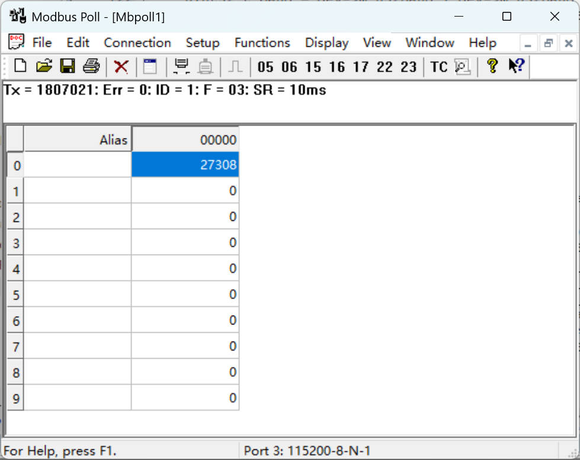

<h1>Libmodbus for MCU</h1>

<p align="center">
  
</p>

**Libmodbus for MCU** 将开源 [libmodbus](https://libmodbus.org/) 协议栈适配到资源受限的 MCU 平台，通过 RTOS、轻量级 TCP/IP 协议栈以及板级 UART/DMA 端口，实现 Modbus RTU 和 Modbus TCP 通信。

当前代码基于 libmodbus 3.1.11，已经在 STM32F429、GD32F527 和 AT32F407 平台完成实际项目验证。

[](https://www.gnu.org/licenses/old-licenses/lgpl-2.1.html) [](https://en.wikipedia.org/wiki/C_(programming_language))

**中文简体** ｜ [**English**](./docs/README_EN.md)

---

## 功能特性

- 支持多个 Modbus RTU Master 和 Slave
- 支持多个 Modbus TCP Master 和 Slave
- 支持同一系统中的多个独立 UART Modbus 设备
- 使用 RTU 帧间隔控制连续报文发送
- TCP 后端通过 lwIP BSD Socket API 工作
- 协议栈、公共适配接口和板级端口相互分离

## 已验证平台

| MCU | 端口目录 | 验证状态 | 说明 |
| --- | --- | --- | --- |
| STM32F429 | `arch/ports/stm32f429/` | 已验证 | 仓库包含完整 MDK/CMake 示例工程 |
| GD32F527 | `arch/ports/gd32f527/` | 已验证 | USART1/USART2、DMA、GPIO 方向控制参考实现 |
| AT32F407 | `arch/ports/at32f407/` | 已验证 | USART2、DMA、GPIO 方向控制参考实现 |

端口文件中的 UART、DMA 通道、GPIO 和中断函数均与验证板卡资源绑定。移植到同系列的其他板卡时，仍需要根据原理图和芯片资源重新配置。

## 软件目录

```text
Libmodbus-for-MCU/
├── src/                         Modbus 协议栈源码
│   ├── include/                 公共 API 和协议栈内部头文件
│   ├── modbus.c                 通用请求、响应和数据映射处理
│   ├── modbus-data.c            位与寄存器数据辅助函数
│   ├── modbus-rtu.c             RTU 后端及 MCU UART 接口桥接
│   └── modbus-tcp.c             TCP/TCP-PI 后端
├── arch/                        MCU 公共适配接口与板级端口
│   ├── modbus-port.h            RTOS 与网络协议栈类型、接口映射
│   ├── modbus-rtu-hal.h         UART 设备抽象和板级驱动接口
│   └── ports/                   板级 RTU UART/DMA 实现
│       ├── stm32f429/
│       ├── gd32f527/
│       └── at32f407/
├── tests/
│   ├── modbus_test.h            测试参数和四个测试函数声明
│   └── modbus_test.c            RTU/TCP 主从站板级集成测试
├── examples/
│   └── stm32f429igt6/           STM32F429 FreeRTOS + lwIP 完整工程
├── docs/                        英文说明及图片资源
├── LICENSE
└── README.md
```

## 依赖组件

- FreeRTOS 10.4.6
- lwIP 2.1.3
- libmodbus 3.1.11
- 对应 MCU 的外设驱动库
  - STM32F429：STM32 HAL
  - GD32F527：GD32 Firmware Library
  - AT32F407：AT32 Firmware Library

## 使用方法

### 1. 添加公共源码

目标工程需要编译以下公共源文件：

```text
src/modbus.c
src/modbus-data.c
src/modbus-rtu.c
src/modbus-tcp.c
```

并添加头文件搜索路径：

```text
src/include
arch
```

### 2. 选择一个板级端口

每个目标工程只能编译一个 RTU 板级实现：

```text
arch/ports/stm32f429/modbus-rtu-hal.c
arch/ports/gd32f527/modbus-rtu-hal.c
arch/ports/at32f407/modbus-rtu-hal.c
```

### 3. 配置 MCU 与厂商驱动

板级 `modbus-rtu-hal.c` 直接包含对应厂商的设备头文件，公共 `arch/modbus-port.h` 不依赖具体 MCU SDK。
新增 MCU 时，在 `arch/ports/<mcu>/` 中提供对应的 `modbus-rtu-hal.c` 即可，

### 4. 配置 RTOS

当前端口使用 FreeRTOS，工程需要定义：

```c
#define __MCU__
#define USING_OS_TYPE_FREERTOS
```

公共接口使用以下 FreeRTOS 能力：

- 二值信号量
- ISR 中释放信号量
- 系统 Tick 和毫秒转换
- 任务延时与临界区

### 5. 配置 lwIP

使用 Modbus TCP 时定义：

```c
#define USING_NET_STACK_LWIP
```

并在 `lwipopts.h` 中确认：

```text
LWIP_SOCKET = 1
LWIP_COMPAT_SOCKETS = 0
LWIP_SOCKET_SELECT = 1
LWIP_POSIX_SOCKETS_IO_NAMES = 1
LWIP_NETCONN = 1
SO_REUSE = 1
```

`arch/modbus-port.h` 会将 `modbus_net_xxx` 接口映射到 lwIP Socket API。

若使用其他支持 BSD socket 接口的 TCP/IP 协议栈（如 uC/TCP-IP、embOS/IP等），需要在 modbus_net_xxx 接口处进行适配。例如，将 modbus_net_send、modbus_net_recv 等宏定义映射为对应协议栈的 socket 函数。

> 注意：若使用的 TCP/IP 协议栈不支持标准 BSD socket，则无法直接适配这些接口。

## RTU 板级接口

libmodbus 最初设计用于 Linux, Mac OS X, FreeBSD, Embox, QNX 和 Windows等支持标准 POSIX I/O 接口的平台，其串口通信层完全依赖于主机操作系统提供的标准 POSIX I/O 接口和内核驱动模型，这些接口通常在 MCU 环境中并不存在。因此，在移植 libmodbus 到 MCU 平台时，需要重写串口相关的底层驱动接口，通常包括初始化、发送、接收、方向控制等功能。

`arch/modbus-rtu-hal.h` 是所有 MCU 端口共用的唯一 UART 设备接口头文件。
每一个 Modbus UART 设备需要配置：

- 设备名和设备 ID
- 独立接收缓冲区
- 接收长度和状态
- 发送状态、错误统计和 RTU 帧间隔状态
- 收发完成信号量
- 指向板级硬件上下文的 `m_pvPortContext`
- `init`、`send`、`recv`、`flush` 和 `dir_switch` 回调

每个板级端口使用统一的 `stUartContext` 类型名保存这些句柄，并可在基础成员之后增加该平台需要的 DMA
控制器、GPIO、时钟和中断等资源。例如 STM32 端口使用：

```c
typedef struct
{
  UART_HandleTypeDef m_stHalHandle;
  DMA_HandleTypeDef m_stTxDmaHandle;
  DMA_HandleTypeDef m_stRxDmaHandle;
} stUartContext;

#define UART_CONTEXT(dev) \
  ((stUartContext *)((dev)->m_pvPortContext))
#define UART_HANDLE(dev)   (UART_CONTEXT(dev)->m_stHalHandle)
#define TX_DMA_HANDLE(dev) (UART_CONTEXT(dev)->m_stTxDmaHandle)
#define RX_DMA_HANDLE(dev) (UART_CONTEXT(dev)->m_stRxDmaHandle)
```

设备表以公共枚举 `MODBUS_UART1`、`MODBUS_UART2`、`MODBUS_UART3` 为索引，
公共成员使用 `m_enDevId` 保存设备 ID。板级源码通过指定初始化器将实际存在的设备
放入对应位置；未使用的位置保持为 `NULL`。

应用通过设备名创建 RTU 上下文：

```c
modbus_t *ctx = modbus_new_rtu("uart2", 115200, 'N', 8, 1);

if ((ctx == NULL) || (modbus_connect(ctx) == -1))
{
    /* error handling */
}
```

`modbus_connect()` 会调用所选端口的初始化回调，只有 UART、DMA、接收通道和同步对象准备完成后才会进入连接状态。

## 示例工程

STM32F429 示例位于：

```text
examples/stm32f429igt6/
```

工程支持：

- Keil MDK：`Projects/MDK-ARM/atk_f429.uvprojx`
- CMake + Arm GNU Toolchain：`CMakeLists.txt`


## 板级集成测试框架

`tests/modbus_test.c` 仅提供四个可直接作为 RTOS 任务入口的测试函数：

```c
void modbus_rtu_master_test(void *parameters);
void modbus_rtu_slave_test(void *parameters);
void modbus_tcp_master_test(void *parameters);
void modbus_tcp_slave_test(void *parameters);
```

各芯片示例中的 `freertos_demo.c` 负责初始化板级组件和网络，然后通过 `xTaskCreate()` 调用需要的测试函数。

默认测试参数位于 `tests/modbus_test.h`，可以在工程编译选项中覆盖，例如：

```c
#define MODBUS_TEST_RTU_MASTER_DEVICE "uart1"
#define MODBUS_TEST_TCP_MASTER_IP     "192.168.1.100"
```

STM32F429 示例默认同时创建四个测试任务：

- RTU Master：`uart3`，访问 Slave ID 2
- RTU Slave：`uart2`，Slave ID 1
- TCP Master：连接 `172.18.57.22:6805`
- TCP Slave：监听 `172.18.57.30:6801`

测试前应根据实际串口连接和网络配置调整这些参数。

## 测试结果

### 功能测试

使用 Modbus 调试工具进行功能测试，结果如下：



打印信息如下：


### 压力测试

同时运行 Modbus RTU 主从站和 Modbus TCP 主从站进行压力测试。测试期间，Modbus RTU 累计收发 180 万帧，0丢包。

<p align="center">
  
</p>

## 许可证

本项目遵循 LGPL-2.1-or-later，详见 [LICENSE](./LICENSE)。示例工程中使用的第三方组件分别遵循其自身许可证。

## 联系方式

- Author: William Chen
- Email: william_engineer@outlook.com
