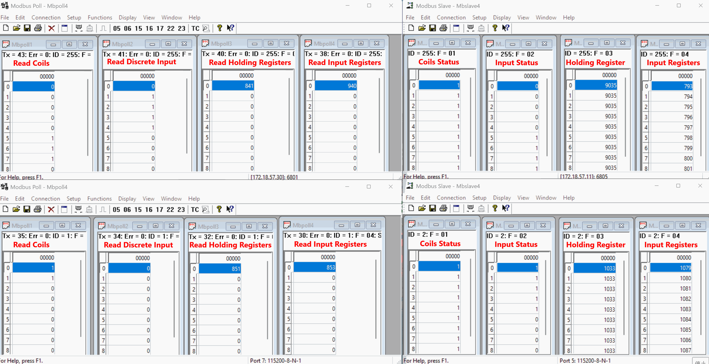
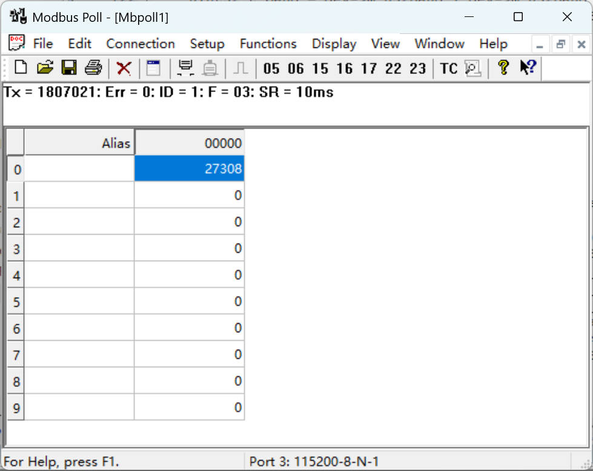

<h1>Libmodbus for MCU</h1>

<p align="center">
  
</p>

**Libmodbus for MCU** adapts the open-source [libmodbus](https://libmodbus.org/) protocol stack to
resource-constrained MCU platforms. It provides Modbus RTU and Modbus TCP communication through an RTOS, a lightweight
TCP/IP stack, and board-level UART/DMA ports.

The current code is based on libmodbus 3.1.11 and has been validated in real projects on STM32F429, GD32F527, and
AT32F407 platforms.

[](https://www.gnu.org/licenses/old-licenses/lgpl-2.1.html) [](https://en.wikipedia.org/wiki/C_(programming_language))

**English** ｜ [**中文简体**](../README.md)

---

## Features

- Supports multiple Modbus RTU masters and slaves
- Supports multiple Modbus TCP masters and slaves
- Supports multiple independent UART Modbus devices in the same system
- Controls the RTU inter-frame interval between consecutive transmissions
- Uses the lwIP BSD Socket API for the TCP backend
- Separates the protocol stack, common adaptation interfaces, and board-level ports

## Validated Platforms

| MCU | Port directory | Status | Description |
| --- | --- | --- | --- |
| STM32F429 | `arch/ports/stm32f429/` | Validated | The repository includes a complete MDK/CMake example project |
| GD32F527 | `arch/ports/gd32f527/` | Validated | Reference implementation for USART1/USART2, DMA, and GPIO direction control |
| AT32F407 | `arch/ports/at32f407/` | Validated | Reference implementation for USART2, DMA, and GPIO direction control |

The UART instances, DMA channels, GPIO pins, and interrupt handlers in each port are tied to the resources of the
validated board. When porting to another board in the same MCU family, reconfigure them according to the schematic and
the available MCU resources.

## Directory Structure

```text
Libmodbus-for-MCU/
├── src/                         Modbus protocol stack sources
│   ├── include/                 Public API and internal protocol stack headers
│   ├── modbus.c                 Common request, response, and data-mapping handling
│   ├── modbus-data.c            Bit and register data helper functions
│   ├── modbus-rtu.c             RTU backend and MCU UART interface bridge
│   └── modbus-tcp.c             TCP/TCP-PI backends
├── arch/                        Common MCU adaptation interfaces and board-level ports
│   ├── modbus-port.h            RTOS and network-stack types and interface mappings
│   ├── modbus-rtu-hal.h         UART device abstraction and board driver interface
│   └── ports/                   Board-level RTU UART/DMA implementations
│       ├── stm32f429/
│       ├── gd32f527/
│       └── at32f407/
├── tests/
│   ├── modbus_test.h            Test parameters and declarations for the four test functions
│   └── modbus_test.c            Board-level RTU/TCP master and slave integration tests
├── examples/
│   └── stm32f429igt6/           Complete STM32F429 FreeRTOS + lwIP project
├── docs/                        English documentation and image assets
├── LICENSE
└── README.md
```

## Dependencies

- FreeRTOS 10.4.6
- lwIP 2.1.3
- libmodbus 3.1.11
- Peripheral driver library for the target MCU
  - STM32F429: STM32 HAL
  - GD32F527: GD32 Firmware Library
  - AT32F407: AT32 Firmware Library

## Usage

### 1. Add the Common Sources

Compile the following common source files in the target project:

```text
src/modbus.c
src/modbus-data.c
src/modbus-rtu.c
src/modbus-tcp.c
```

Add these header search paths:

```text
src/include
arch
```

### 2. Select a Board-Level Port

Each target project must compile exactly one RTU board-level implementation:

```text
arch/ports/stm32f429/modbus-rtu-hal.c
arch/ports/gd32f527/modbus-rtu-hal.c
arch/ports/at32f407/modbus-rtu-hal.c
```

### 3. Configure the MCU and Vendor Drivers

Each board-level `modbus-rtu-hal.c` directly includes the corresponding vendor device header. The common
`arch/modbus-port.h` does not depend on a specific MCU SDK. To add a new MCU, provide its `modbus-rtu-hal.c` under
`arch/ports/<mcu>/`.

### 4. Configure the RTOS

The current ports use FreeRTOS. Define the following macros in the project:

```c
#define __MCU__
#define USING_OS_TYPE_FREERTOS
```

The common interface uses these FreeRTOS features:

- Binary semaphores
- Giving semaphores from an ISR
- System ticks and millisecond conversion
- Task delays and critical sections

### 5. Configure lwIP

Define the following macro when using Modbus TCP:

```c
#define USING_NET_STACK_LWIP
```

Confirm the following settings in `lwipopts.h`:

```text
LWIP_SOCKET = 1
LWIP_COMPAT_SOCKETS = 0
LWIP_SOCKET_SELECT = 1
LWIP_POSIX_SOCKETS_IO_NAMES = 1
LWIP_NETCONN = 1
SO_REUSE = 1
```

`arch/modbus-port.h` maps the `modbus_net_xxx` interfaces to the lwIP Socket API.

When using another TCP/IP stack that supports the BSD socket interface, such as uC/TCP-IP or embOS/IP, adapt the
`modbus_net_xxx` interfaces accordingly. For example, map the `modbus_net_send` and `modbus_net_recv` macros to the
socket functions provided by that stack.

> Note: A TCP/IP stack that does not support the standard BSD socket interface cannot be adapted through these mappings
> directly.

## RTU Board-Level Interface

Libmodbus was originally designed for platforms such as Linux, macOS, FreeBSD, Embox, QNX, and Windows that provide
standard POSIX I/O interfaces. Its serial communication layer relies entirely on the POSIX I/O interfaces and kernel
driver model provided by the host operating system, which are generally unavailable in MCU environments. Therefore,
porting libmodbus to an MCU requires reimplementing the low-level serial interfaces, including initialization,
transmission, reception, and direction control.

`arch/modbus-rtu-hal.h` is the single shared UART device interface header used by all MCU ports. Each Modbus UART device
must provide:

- A device name and device ID
- An independent receive buffer
- Receive length and state
- Transmission state, error counters, and RTU inter-frame timing state
- Send and receive completion semaphores
- `m_pvPortContext`, which points to the board-level hardware context
- `init`, `send`, `recv`, `flush`, and `dir_switch` callbacks

Each board-level port uses the common `stUartContext` type name to store these handles and may append platform-specific
resources such as a DMA controller, GPIOs, clocks, and interrupts after the basic members. For example, the STM32 port
uses:

```c
typedef struct
{
  UART_HandleTypeDef m_stHalHandle;
  DMA_HandleTypeDef m_stTxDmaHandle;
  DMA_HandleTypeDef m_stRxDmaHandle;
} stUartContext;

#define UART_CONTEXT(dev) \
  ((stUartContext *)((dev)->m_pvPortContext))
#define UART_HANDLE(dev)   (UART_CONTEXT(dev)->m_stHalHandle)
#define TX_DMA_HANDLE(dev) (UART_CONTEXT(dev)->m_stTxDmaHandle)
#define RX_DMA_HANDLE(dev) (UART_CONTEXT(dev)->m_stRxDmaHandle)
```

The device table is indexed by the common `MODBUS_UART1`, `MODBUS_UART2`, and `MODBUS_UART3` enumeration values. The
common `m_enDevId` member stores the device ID. A board-level source file places each available device at its matching
index with designated initializers; unused entries remain `NULL`.

The application creates an RTU context by device name:

```c
modbus_t *ctx = modbus_new_rtu("uart2", 115200, 'N', 8, 1);

if ((ctx == NULL) || (modbus_connect(ctx) == -1))
{
    /* error handling */
}
```

`modbus_connect()` invokes the initialization callback of the selected port. The connection enters the ready state only
after the UART, DMA, receive channel, and synchronization objects have been initialized successfully.

## Example Project

The STM32F429 example is located at:

```text
examples/stm32f429igt6/
```

The project supports:

- Keil MDK: `Projects/MDK-ARM/atk_f429.uvprojx`
- CMake + Arm GNU Toolchain: `CMakeLists.txt`

## Board-Level Integration Test Framework

`tests/modbus_test.c` provides only four test functions that can be used directly as RTOS task entry points:

```c
void modbus_rtu_master_test(void *parameters);
void modbus_rtu_slave_test(void *parameters);
void modbus_tcp_master_test(void *parameters);
void modbus_tcp_slave_test(void *parameters);
```

The `freertos_demo.c` file in each MCU example initializes the board components and network, then starts the required
test functions with `xTaskCreate()`.

Default test parameters are defined in `tests/modbus_test.h` and can be overridden through project compiler options. For
example:

```c
#define MODBUS_TEST_RTU_MASTER_DEVICE "uart1"
#define MODBUS_TEST_TCP_MASTER_IP     "192.168.1.100"
```

By default, the STM32F429 example creates all four test tasks:

- RTU Master: `uart3`, accessing Slave ID 2
- RTU Slave: `uart2`, Slave ID 1
- TCP Master: connects to `172.18.57.22:6805`
- TCP Slave: listens on `172.18.57.30:6801`

Adjust these parameters according to the actual serial connections and network configuration before testing.

## Test Results

### Functional Test

The results of functional tests performed with Modbus debugging tools are shown below:



The debug log is shown below:


### Stress Test

The Modbus RTU master and slave and the Modbus TCP master and slave were run simultaneously for stress testing. During
the test, Modbus RTU transmitted and received a total of 1.8 million frames with zero packet loss.

<p align="center">
  
</p>

## License

This project is licensed under LGPL-2.1-or-later. See [LICENSE](../LICENSE) for details. Third-party components used by
the example project are governed by their respective licenses.

## Contact

- Author: William Chen
- Email: william_engineer@outlook.com
